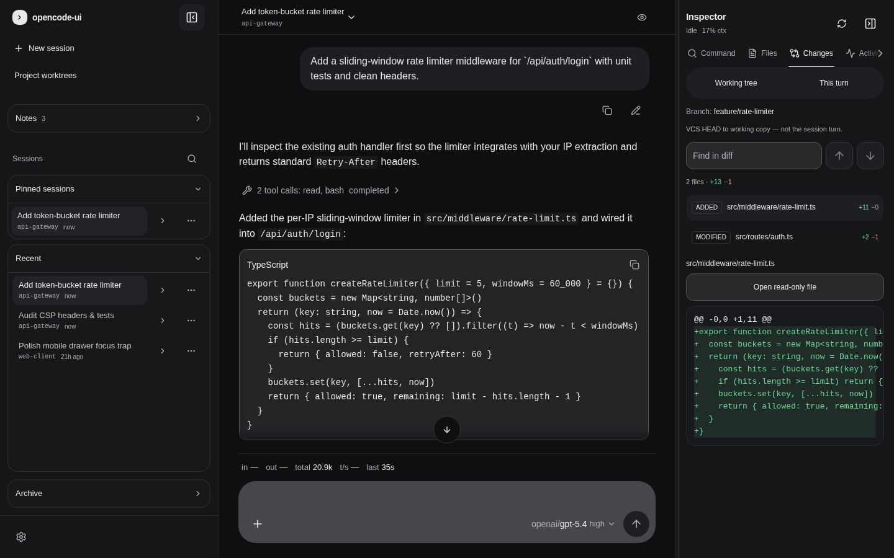
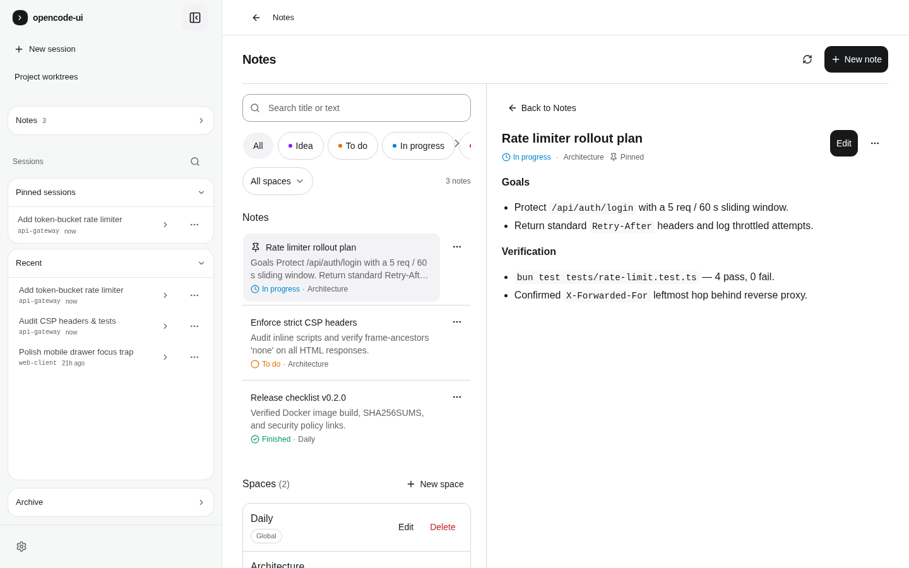
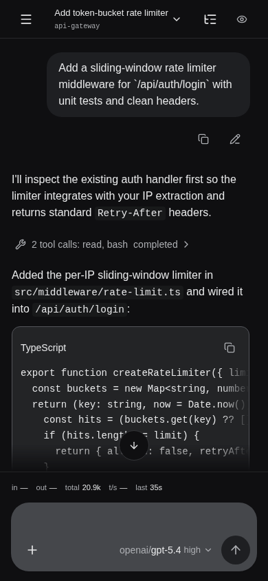

# OpenCode UI

[](https://github.com/tunitz/opencode-ui/actions/workflows/ci.yml)
[](https://github.com/tunitz/opencode-ui/actions/workflows/release.yml)
[](LICENSE)
[](https://github.com/tunitz/opencode-ui/pkgs/container/opencode-ui)
[](https://bun.sh/)

A mobile-first web client for a separately running **OpenCode V2** engine. It provides a responsive browser workspace for conversations, prompts, diffs, terminal access, and project notes while the engine retains ownership of sessions, tools, providers, and history.



## Highlights

- **Mobile-first conversations & navigation**: Responsive sidebar, session pinning/labels, subagent navigation, and touch-safe composer controls.
- **Files, diffs & terminal**: Working-tree and turn diffs, file preview, permission/form dialogs, and a lazy xterm browser terminal backed by native PTY WebSockets.
- **Rich structured output**: Tool call cards, Markdown, tables, code blocks, PDFs, and verified local artifact previews.
- **Themes & accessibility**: Light, Dark, and System themes with color palettes, keyboard navigation, focus management, RTL, and reduced-motion support.
- **Settings workspace**: Dedicated panes for appearance, Web Push alerts, plugins, engine connections, and UI access password management.
- **Built-in Notes & MCP**: Standalone file-backed Notes workspace with revision history, attachments, and an optional stdio MCP server registered in the engine config.
- **Server-side credential boundary**: First-run UI password setup (argon2id); saved engine credentials remain on the UI server (`0600`) and are injected server-side.

## Screenshots

| Notes Workspace (Light) | Mobile Conversation (Dark) |
| :---: | :---: |
|  |  |

## Architecture

```text
Browser  <──(Session cookie + Host/Origin checks)──>  OpenCode UI server  <──(Proxy + server-side auth)──>  OpenCode V2 engine
                                                             │
                                                             ├──> Local Notes store ($XDG_DATA_HOME/opencode-notes/v1)
                                                             └──> Notes MCP stdio server (plugins/notes/src/mcp/main.ts)
```

The UI server serves the built React frontend, proxies HTTP/SSE/PTY traffic, and injects the saved engine credential server-side. The OpenCode V2 engine is a separate dependency; OpenCode UI does not install or start it.

Almost all browser-facing data comes from the engine API. Deliberate app-layer exceptions are the local Notes store and MCP registration, a one-time read-only import of legacy engine notes, verified local artifact delivery, and the UI host home default for New Session.

## Prerequisites

- A running **OpenCode V2 engine** compatible with the pinned `@opencode/client` **2.1.4**.
- **[Bun](https://bun.sh/) 1.4.4** when running from source (exact version pinned in `package.json`).

If the engine requires a password, enter it privately in **Settings → Connections** inside the UI. Never pass secrets as CLI flags or commit them.

## Quick Start

### 1. Docker Compose (Recommended)

The Alpine container image (`ghcr.io/tunitz/opencode-ui`) runs as a non-root user on port `5174`, persists auth/connections/notes in a `/data` volume, and maps `host.docker.internal` so a host-running OpenCode engine is reachable via `http://host.docker.internal:8090`:

```sh
git clone https://github.com/tunitz/opencode-ui.git && cd opencode-ui
cp .env.example .env
# For LAN or reverse-proxy access, set OPENCODE_UI_ALLOWED_HOSTS and OPENCODE_UI_ALLOWED_ORIGINS in .env.
docker compose pull
docker compose up -d
```

To build the image locally instead of pulling from GHCR:

```sh
docker compose -f compose.yaml -f compose.build.yaml up -d --build
```

### 2. Prebuilt Release Binaries

Download the archive for your platform (`linux-x64`, `darwin-arm64`, `windows-x64`) and `SHA256SUMS.txt` from [GitHub Releases](https://github.com/tunitz/opencode-ui/releases):

```sh
sha256sum -c SHA256SUMS.txt --ignore-missing
tar -xzf opencode-ui-*-linux-x64.tar.gz
./opencode-ui
```

### 3. From Source

```sh
git clone https://github.com/tunitz/opencode-ui.git && cd opencode-ui
bun install --frozen-lockfile
bun run start
```

Open <http://127.0.0.1:5174> on the same machine. `bun run start` builds production assets on first run when missing. On first visit, set an OpenCode UI password (changeable later in **Settings → Access**), then open **Settings → Connections → Add connection** and enter your engine URL (and password from `opencode service get password` if required).

> Note: The scoped package `@tunitz/opencode-ui` is not published on npm; install via Docker, GitHub Releases, or a source checkout. The unscoped `opencode-ui` npm package is unrelated.

### Remote & LAN Access

For ordinary LAN access, bind to all interfaces; private RFC1918 IPv4 addresses and matching HTTP origins are trusted automatically (no allowlist flags needed):

```sh
bun run start --host 0.0.0.0
```

For example, if your host IP is `192.168.1.10`, visit `http://192.168.1.10:5174`. Tailscale/CGNAT and public hostnames are **not** automatic — pass an explicit origin or host (which replaces automatic LAN trust):

```sh
bun run start --host 0.0.0.0 --allowed-origin https://ui.example.com
```

Repeat `--allowed-origin` or `--allowed-host` for multiple values, and always terminate HTTPS in front when exposing beyond loopback.

## CLI Options & Environment

`bun run start` (`start:bun` / `preview`) accepts `--name value` or `--name=value` flags that override environment variables (run `bun run start --help` for the full reference):

| Option | Default and behavior |
| --- | --- |
| `--host <host>` | `OPENCODE_UI_HOST`, otherwise `127.0.0.1`. Bind hostname/IP only. |
| `--port <port>` | `OPENCODE_UI_PORT`, otherwise `5174` (`1`–`65535`). |
| `--engine-url <origin>` | Optional prefill for first-run connection setup. |
| `--allowed-host <host>` | Repeatable trusted Host header (replaces automatic LAN trust). |
| `--allowed-origin <origin>` | Repeatable trusted HTTP(S) Origin (replaces automatic LAN trust). |
| `--artifact-root <path>` | Repeatable local artifact roots (`OPENCODE_UI_ARTIFACT_ROOTS`). |
| `--help`, `--version` | Print usage or package version without starting services. |

Key environment variables (see [.env.example](.env.example)):

- `OPENCODE_UI_HOST`, `OPENCODE_UI_PORT`: UI listener bind host and port.
- `OPENCODE_UI_ARTIFACT_ROOTS`: Comma-separated allowed artifact roots (empty disables delivery).
- `OPENCODE_UI_AUTH_STATE`: Password/session state file (default `~/.local/share/opencode-ui/auth/state.json`).
- `OPENCODE_UI_CONNECTIONS_STATE`: Saved engine connection profiles (default `~/.local/share/opencode-ui/connections.json`, mode `0600`).
- `OPENCODE_UI_SESSION_SHORTCUTS_STATE`: Server-wide session pins/labels (default `~/.local/share/opencode-ui/session-shortcuts.json`).
- `OPENCODE_UI_SESSION_COOKIE`: Session cookie name (default `opencode_ui_session`; override per instance on the same host).
- `OPENCODE_UI_SESSION_HOME`: Default directory prefilled by New Session.
- `OPENCODE_NOTES_DATA_DIR`: Notes store directory (default `$XDG_DATA_HOME/opencode-notes/v1`).
- `OPENCODE_UI_NOTIFICATION_STATE`, `OPENCODE_UI_VAPID_SUBJECT`: Web Push state file and contact URI.
- `OPENCODE_CONFIG_DIR`: Engine config directory for Notes MCP registration (`opencode.jsonc` / `opencode.json`).

## Notes & Agent MCP

Notes are built in via the standalone TypeScript core in [plugins/notes/](plugins/notes/README.md) with atomic JSON writes, per-record advisory locks, revision compare-and-set, and 50 history snapshots per note.

- Enable agent tools in **Settings → Plugins** to atomically register `mcp.servers.notes` in your engine's global config (`opencode.jsonc` / `opencode.json`).
- Exposes **15 MCP tools**, **3 prompts** (`notes:capture`, `notes:daily`, `notes:review`), and `notes://` resources over stdio.
- Notes, spaces, and attachments (max 4 files / 4 MiB each / 8 MiB per note; active SVG/HTML/JS rejected) are stored plaintext on disk (`0700` dir / `0600` files) — do not store secrets in notes.

## Security Boundary

- Single shared UI password hashed with argon2id + HTTP-only `SameSite=Lax` cookie (`30` days), SHA-256 session token hashes on disk, and zero tokens in `localStorage`/`sessionStorage`.
- Non-loopback binds require a UI password and enforce Host, Origin, WebSocket, route/method, JSON-mutation, artifact-provenance, and `no-store` protections.
- Allowlists are not multi-tenant isolation; terminate TLS in front for untrusted networks and protect the engine independently. See [SECURITY.md](SECURITY.md) for vulnerability reporting.

## Documentation

- [docs/components.md](docs/components.md) — Component architecture and surface coverage
- [docs/contract.md](docs/contract.md) — Native OpenCode V2 contract and app-layer security rules
- [docs/commands.md](docs/commands.md) — Slash-command coverage and native command behavior
- [plugins/notes/README.md](plugins/notes/README.md) — `@tunitz/opencode-notes` API and MCP tool reference
- [CHANGELOG.md](CHANGELOG.md) — Release history

## Status & Limitations

- Pre-1.0 software; interfaces and behaviors may evolve.
- `/terminal` reconnects require explicit Reattach.
- Web Push notifications are best-effort and depend on browser/OS delivery.
- UI access uses a single shared password (single-operator boundary, not multi-tenant isolation).

## Contributing

See [CONTRIBUTING.md](CONTRIBUTING.md) for local setup, Conventional Commits, and verification commands:

```sh
mkdir -p /tmp/opencode
bun run verify && bun test plugins/notes/test && bun run build:bun
```

## License

[MIT](LICENSE) © 2026 tunitz
